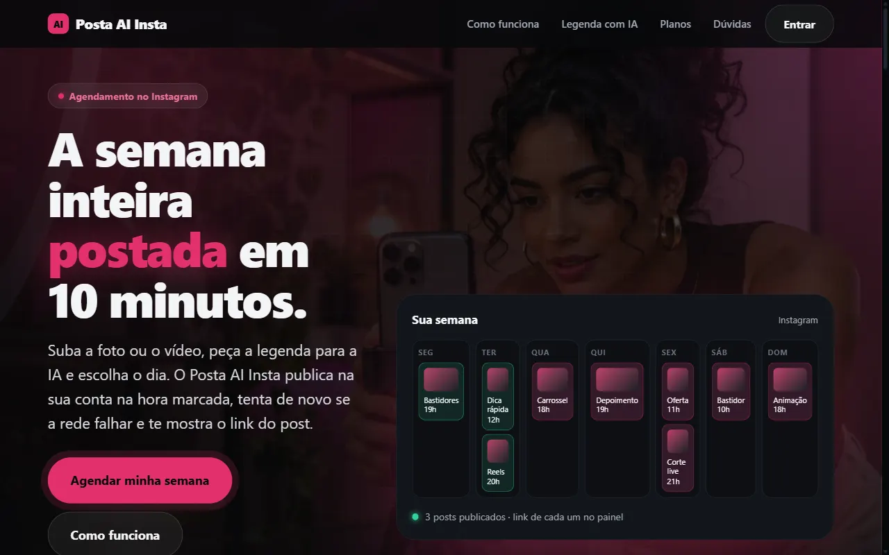
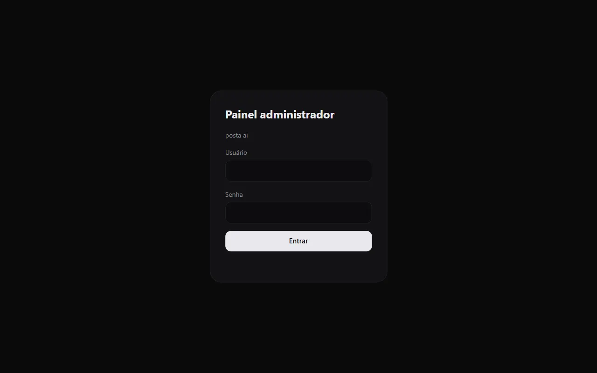

<!-- readme-padrao -->
# Posta AI

> Posta AI (posta-insta/face/tiktok/linkdn): agenda e publica posts na conta do cliente pelo perfil-navegador, com legenda por IA, calendário, rascunhos e reenvio. Use para mexer no Posta AI ou na importação de conteúdo de outros produtos.



## O que é
Posta AI (posta-insta/face/tiktok/linkdn): agenda e publica posts na conta do cliente pelo perfil-navegador, com legenda por IA, calendário, rascunhos e reenvio. Use para mexer no Posta AI ou na importação de conteúdo de outros produtos.

Estado: **no ar**. Produto da Rangel Tech, vendido pela Cakto (conta do Lucas). Registro único dos produtos: `vps_rt_infra/registro/produtos.yml` (spec 57).

## Onde está no ar
- https://posta-ai.rangeltech.net

Variantes que usam este mesmo código:
- **Posta AI Insta**: https://posta-insta.rangeltech.net (mesmo código, outra "pele" por endereço; vendido como produto separado)
- **Posta AI Face**: https://posta-face.rangeltech.net (mesmo código, outra "pele" por endereço; vendido como produto separado)
- **Posta AI TikTok**: https://posta-tiktok.rangeltech.net (mesmo código, outra "pele" por endereço; vendido como produto separado)
- **Posta AI LinkedIn**: https://posta-linkdn.rangeltech.net (mesmo código, outra "pele" por endereço; vendido como produto separado)

**Painel do administrador:** `https://posta-ai.rangeltech.net/admin` (login único dos produtos; a credencial está no Infisical, `rt-produtos/_admin`).



O usuário de teste (QA) de cada produto é obtido no painel único (`painel.rangeltech.net`, aba do produto).

## Onde faz o deploy
Este repositório **só publica** o artefato; **quem implanta é o `vps_rt_infra`** (nenhum container é trocado à mão).

1. Publicar a release: criar a tag (`v*`); o workflow `.github/workflows/release.yml` gera a imagem e o `release-manifest.json` e publica como release.
2. Implantar (de madrugada, 00h às 06h de Brasília): `gh workflow run deploy.yml --repo RangelTech/vps_rt_infra -f service=postaai`
   - Só validar, sem implantar: acrescentar `-f dry_run=true`.
3. Voltar uma versão (rollback): `gh workflow run deploy.yml --repo RangelTech/vps_rt_infra -f service=postaai -f version=<tag-antiga>`.

O serviço no mapa de releases é `postaai` (`vps_rt_infra/releases/sources.json`).

## Como funciona por dentro
- **API e site:** FastAPI (Python) em `app/`, com a landing em `static/`. Container único (`Dockerfile`).
- **Dados:** hoje SQLite no volume do container; **está planejada a migração** para o banco `produtos` do Postgres (um schema por produto) e dos arquivos para o MinIO (spec 57, seções 8 e 8.6).
- **IA:** fala com o Qwen pelo `llm-access` (chave por produto).
- **Cobrança:** webhook da Cakto (`/api/cakto` ou rota equivalente) libera o plano; a conciliação diária compara pedidos e assinaturas.
- **Login:** hoje por código no e-mail; passa para e-mail e senha com captcha invisível e "entrar por link" (spec 57, seção 5A).

## Segredos
Só os **nomes** das variáveis estão neste repositório, em [`segredos.yml`](segredos.yml). Os **valores** ficam no Infisical (projeto `rt-produtos`, ambiente `prod`, pasta `postaai`) e chegam à VPS **gerados no momento do deploy**. Nunca coloque valor de segredo no git.

## Rodar e testar localmente
```bash
python -m venv .venv && source .venv/bin/activate   # no Windows: .venv\Scripts\activate
pip install -r requirements.txt
pytest
```
Os testes de QA em produção são por cliques reais (relatório em PDF no `new_ragente/qa/evidencias`).

## Links
- Painel único: https://painel.rangeltech.net (aba do produto: links, usuário de QA, planos)
- Spec de organização geral: `new_ragente/specs/57_ORGANIZACAO_GERAL_PRODUTOS_E_PAINEL.md`
- Monitor: Uptime Kuma, `postaai`

## Notas técnicas (README anterior)

# Posta AI (Face, Insta, TikTok, Linkdn)

Agenda e publica posts na conta do cliente. Um código, quatro marcas pelo host:
`posta-insta`, `posta-face`, `posta-tiktok`, `posta-linkdn` (`.rangeltech.net`; `posta-ai` = Insta).

- **Conexão** pelo formulário nosso: a senha vai para o `perfil-navegador` (rede interna), que entra na rede **pelo proxy SP**
  e guarda só a sessão, cifrada. TikTok conecta por QR. A tela mostra cada passo (código 2FA, código por e-mail, escolha,
  aprovar no celular, QR, captcha por toque na imagem).
- **Agenda:** foto, vídeo (Reels), carrossel ou texto conforme a rede; legenda com IA; calendário por dia; rascunhos.
- **Worker:** publica na hora marcada; se a rede falhar, tenta de novo em 5, 15 e 30 min e avisa por e-mail; sessão que cai
  marca a conta para reconectar.
- **Importação:** `POST /api/admin/importar` (x-admin-key) cria rascunho para o cliente (Perfilaí, Cortaí, Anima AI).
- Login com senha/código/esqueci (módulo comum), Cakto por marca, painel do ecossistema (`/api/admin/resumo`).

Testes: `pip install -r requirements-dev.txt && python -m pytest -q` (perfil-navegador falso).
Deploy: release neste repo, implantação só pelo `vps_rt_infra`.
